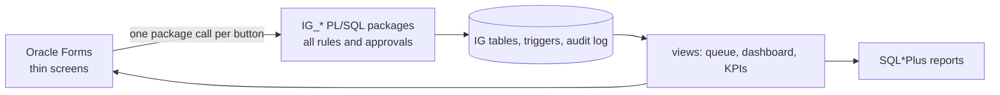
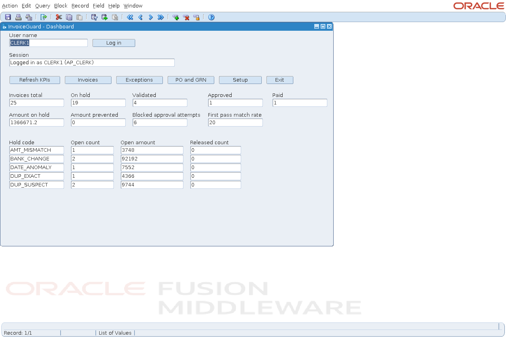
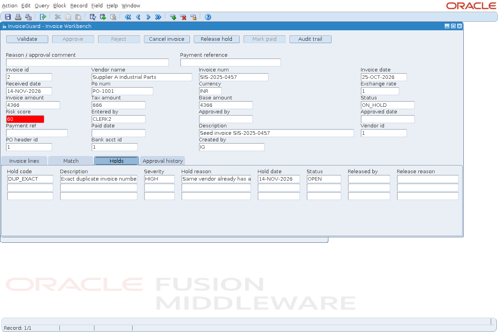
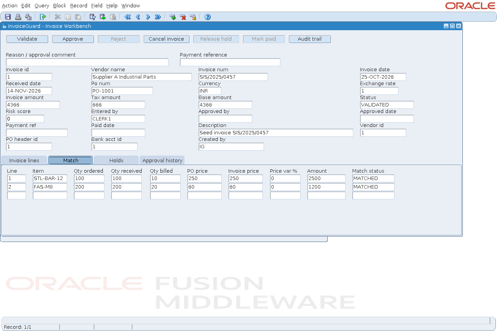
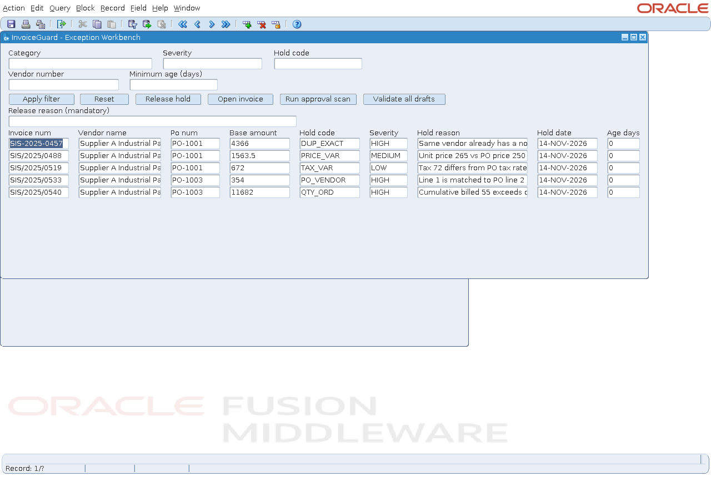
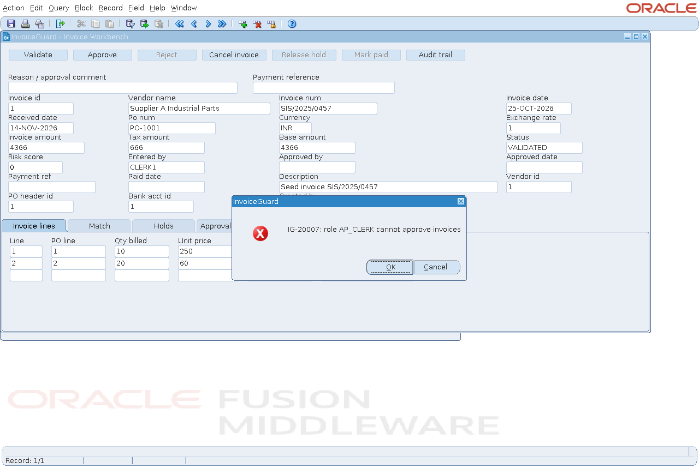
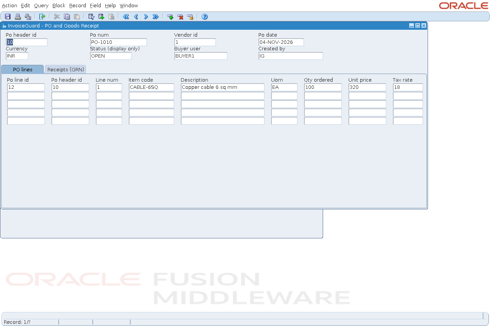

# InvoiceGuard

InvoiceGuard is an accounts-payable control application for Oracle Forms and Oracle Database. It matches each supplier invoice to its purchase order and goods receipt, and holds anything that looks duplicated, mismatched, tampered with or approved without authority. The rules live in PL/SQL packages in the database. The Oracle Forms screens only collect input, call those packages and show the results, so the same rules can later sit behind a different front end.

The database layer is verified on Oracle Database 23ai. The five Forms modules compile with zero errors on Oracle Forms 14.1.2 and run in a Docker stack. See [Verification status](#verification-status).

## Why it matters

- Billing schemes are a common accounts-payable fraud route: the ACFE 2024 Report to the Nations puts them at about 22% of occupational-fraud cases, with a median loss of USD 100,000.
- Duplicate or erroneous payments run at about 0.8% of annual disbursements for top performers and about 2% for bottom performers (APQC benchmark).
- ERP payables modules already hold mismatched invoices (quantity-received and price holds, approval holds released by role). InvoiceGuard follows the same model and adds duplicate, bank-change, split-invoice, GSTIN and approval-authority controls.
- All rules live in PL/SQL, so the Oracle Forms screens can later be replaced by another front end without rewriting the rules.

## What it catches

Each control raises a hold on the invoice. Holds are placed by `ig_match_pkg.validate_invoice` (preventive: the invoice cannot be approved while the hold is open) or by `ig_audit_pkg.scan_approvals` (detective). Full rules and thresholds: [docs/SPEC.md](docs/SPEC.md) section 1.

| Control | Hold code(s) | Preventive / detective | Released by |
|---|---|---|---|
| Exact duplicate invoice | DUP_EXACT | Preventive | Not releasable; the invoice must be cancelled |
| Suspect duplicate (same vendor and amount in the window, or same number and amount at another vendor) | DUP_SUSPECT | Preventive | AP_MANAGER |
| Three-way match: quantity, receipt, price, PO status | QTY_ORD; QTY_REC, NO_RECEIPT, PRICE_VAR, PO_STATUS | Preventive | QTY_ORD: FIN_CONTROLLER; the rest: AP_MANAGER |
| Amount and tax | AMT_MISMATCH, TAX_VAR | Preventive | AP_MANAGER |
| Vendor and PO integrity | PO_VENDOR, VENDOR_STATUS | Preventive | FIN_CONTROLLER |
| Bank-detail change (remit-to account) | BANK_CHANGE | Preventive | FIN_CONTROLLER |
| Invoice split below an approval limit | SPLIT_SUSPECT | Preventive | FIN_CONTROLLER |
| Date, GSTIN and round-amount checks | DATE_ANOMALY, GSTIN_INVALID, ROUND_AMT | Preventive | AP_MANAGER |
| Approval authority and segregation of duties | Blocked approvals (logged, not a hold); UNAUTH_APPROVAL | Blocked approvals: preventive. UNAUTH_APPROVAL: detective (scan of past approvals) | FIN_CONTROLLER |

FIN_CONTROLLER can release any releasable hold. The person who entered an invoice can never release a hold on it.

## Architecture

Thick database, thin Forms. Every rule is in an `IG_*` package. Forms calls one package API per button and renders the result. Details, lifecycle and control matrix: [docs/ARCHITECTURE.md](docs/ARCHITECTURE.md).



## Screens

Captured from the running Oracle Forms 14.1.2 client, with the seeded test data. Vendors are the neutral seed names "Supplier A" to "Supplier F".

| | |
|---|---|
|  |  |
| **Dashboard.** KPIs and open holds by hold code, read from the database views. | **Invoice workbench, Holds tab.** Invoice SIS-2025-0457 is held as an exact duplicate (DUP_EXACT, HIGH). |
|  |  |
| **Match tab.** Line-level three-way match. Both lines of SIS/2025/0457 match the PO. | **Exception workbench.** Open holds across all invoices, with filters, a mandatory release reason and the approval scan. |
|  |  |
| **Blocked approval.** A clerk's approval is refused by the database (IG-20007) and logged as BLOCKED. | **PO and goods receipt.** Purchase orders, PO lines and receipts, used for the match. |

## Run the UI

Needs Docker, about 8 GB RAM and 25 GB disk. The containers are capped (Forms 2 CPU and 5 GB, database 1 CPU).

1. **Oracle installers.** Download the Forms and WebLogic installers from Oracle and place them in `installers/`, with the exact file names listed in [installers/README.md](installers/README.md). The project never downloads them for you.
2. **Database.** `bash scripts/db_up.sh` starts Oracle Database 23ai Free on port 1522, installs the schema and runs the tests.
3. **Forms.** `bash scripts/forms_up.sh` is the one command that builds the Forms 14.1.2 stack, creates the WebLogic domain, compiles the forms and deploys them. The servlet listens on port 9001.
4. **Client.** Start the Forms Standalone Launcher against the named configuration:
   ```bash
   java -jar frmsal.jar -url "http://localhost:9001/forms/frmservlet?config=invoiceguard"
   ```
5. **Log in** with a user name. Login is by user name only, which is a demo convenience and not authentication (see [forms/README.md](forms/README.md) section 7):

   | User | Role | Can do |
   |---|---|---|
   | `CLERK1` | AP_CLERK | Enter and validate invoices. No approvals. |
   | `APMGR1` | AP_MANAGER | Approve up to INR 500,000, release most holds. |
   | `FINCTRL1` | FIN_CONTROLLER | Approve, release any releasable hold, mark paid. |

Stop the stack with `scripts/forms_down.sh` and `scripts/db_down.sh`. Development passwords are defaults in the scripts. Override them with `IG_DB_PASSWORD`, `IG_SYS_PASSWORD`, `IG_RCU_PASSWORD` and `IG_WLS_PASSWORD`. Do not commit real passwords.

## Repository layout

```
invoiceguard/
├── README.md
├── docs/         SPEC, ARCHITECTURE, DEMO_SCRIPT, screenshots/, report/
├── db/           schema, packages, triggers, views, seed data, tests (install.sql, tests/run_tests.sql)
├── forms/        Forms XML, IG_LIB.pld library, trigger code (plsql/), tools/ (generator, static checks)
├── reports/      five SQL*Plus reports
├── docker/       Oracle Forms 14.1.2 and database container definitions
├── installers/   Oracle installers, user-supplied and not in git (see its README)
└── scripts/      db_up, db_test, db_down, run_reports, forms_up, forms_down, build_forms (.sh and .cmd), fsal/
```

## Quick start (database only)

1. `bash scripts/db_up.sh`: database container, schema, tests.
2. `bash scripts/db_test.sh`: reinstalls the schema and runs `db/tests/run_tests.sql`. Expect `SUMMARY: 70 passed, 0 failed`.
3. `bash scripts/run_reports.sh`: copies `reports/` into the container and runs all five. Fails on any `ORA-`, `SP2-` or `PLS-` error.

To rebuild the Forms binaries without the Docker stack, see [forms/README.md](forms/README.md) section 3 (`scripts/build_forms.sh`).

## Demo walkthrough

- [docs/DEMO_SCRIPT.md](docs/DEMO_SCRIPT.md): a five-minute walkthrough with talking points and fallbacks, using the real seeded invoices.
- [db/README_SCENARIOS.md](db/README_SCENARIOS.md): the 25 seeded invoices, the hold each one should raise and what it demonstrates.

## Verification status

**Database, on Oracle Database 23ai Free** (`gvenzl/oracle-free:23.9-slim-faststart`):
- Schema installs clean, with 0 invalid objects.
- `bash scripts/db_test.sh` reports `SUMMARY: 70 passed, 0 failed`.
- All 25 seeded invoices land on their expected holds, and all 17 hold codes fire.
- All 5 SQL*Plus reports run with no Oracle errors.

**Forms, on Oracle Forms 14.1.2**:
- `IG_LIB` and the five forms (`IG_MAIN`, `IG_INVOICE`, `IG_EXCEPTIONS`, `IG_PO_GRN`, `IG_SETUP`) are generated as Forms XML, converted with `frmxml2f` and compiled with `frmcmp_batch` with zero errors.
- The compiled forms run in the Docker stack on WebLogic. The screenshots above were taken from the running Forms Standalone Launcher client.
- `python3 forms/tools/check_refs.py` runs 34 static checks with 0 problems.
- Reproducible: `scripts/forms_up.sh` rebuilt the whole stack from scratch (new image, new WebLogic domain, new RCU schemas), compiled every module, and served the app (HTTP 200); `scripts/forms_screenshot.sh` then captured the logged-in dashboard. See `docker/forms/README.md`.

**Not done yet:**
- The custom menu (`IG_MENU`) is deferred. The standard Forms menu and toolbar are used, and navigation is by dashboard buttons. The menu XML hits FRM-31651 on `frmxml2f`.
- Severity colouring of table rows was removed. Setting a visual attribute in POST-QUERY made the form loop at 100% CPU, so severity shows as text. The risk score keeps its colour.
- Real Forms compile and runtime findings are in [forms/XML_FORMAT_NOTES.md](forms/XML_FORMAT_NOTES.md) and [forms/COMPILE_PITFALLS.md](forms/COMPILE_PITFALLS.md).

## Roadmap (not built)

- Custom menu module, and row-level severity colours in the tabular blocks.
- Integration with Oracle E-Business Suite Payables: read and write AP invoices, holds and approvals through the same packages.
- GST e-invoice check: verify the IRN and QR code of an e-invoice (InvoiceGuard checks GSTIN format, check digit and PAN consistency only).
- Web front end that reuses the same `IG_*` packages, so the rules do not change.
