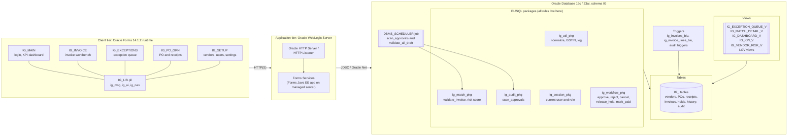
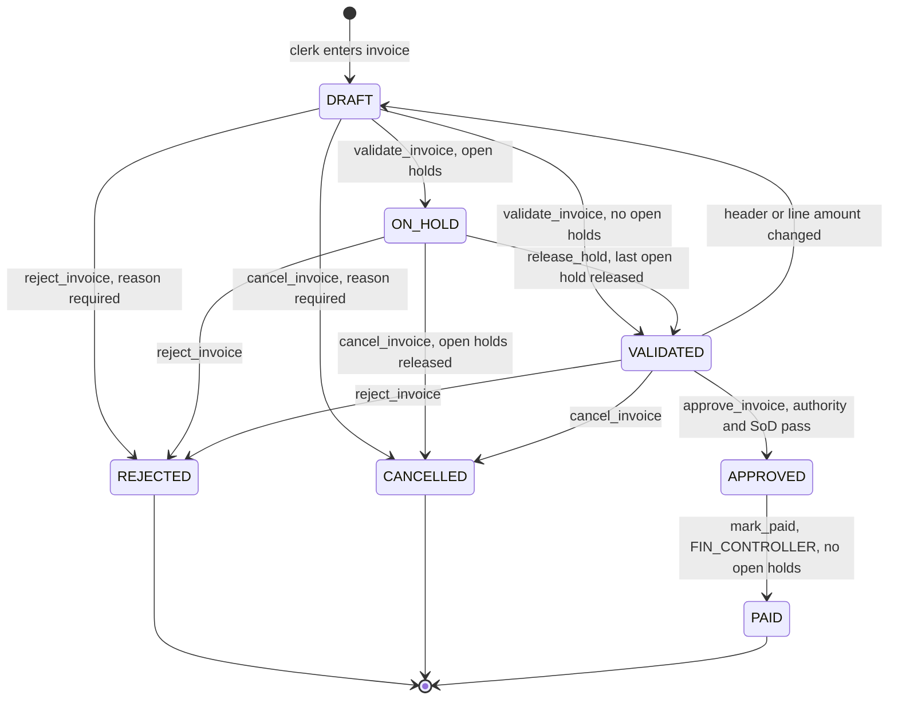
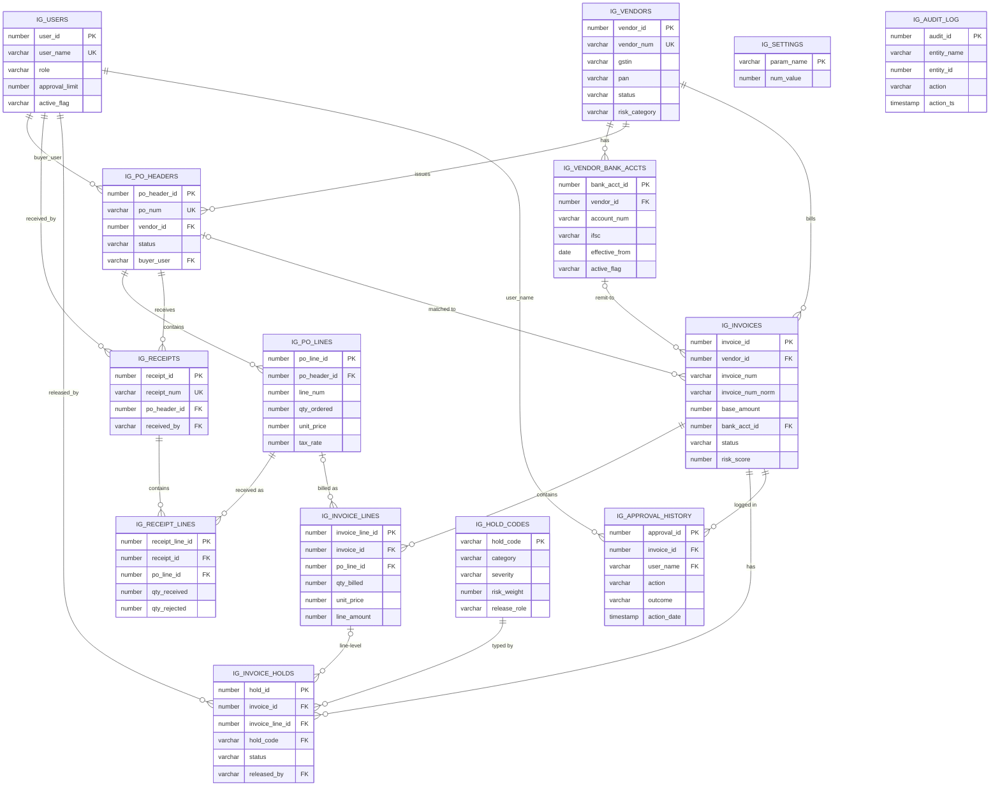

# InvoiceGuard architecture

Source of truth for tables, packages, rules and error codes: `docs/SPEC.md`. This file shows the shape of the system; where it differs from the SPEC, the SPEC wins.

Status: the database layer is verified on Oracle Database 23ai (70 tests pass). The Forms layer compiles with zero errors on Oracle Forms 14.1.2 and runs in the Docker stack; the custom menu is deferred. See `forms/README.md`.

## 1. System architecture

Notes:
- Forms never writes `status`, `risk_score`, `approved_by` or hold rows directly. Every button calls one package API inside an exception handler (SPEC §7).
- The scheduler job is a design choice for batch re-validation and the post-facto approval scan. The SPEC describes both procedures; the job itself is a proposed deployment step.
- Views are read-only for Forms, except the LOVs.

## 2. Invoice lifecycle

Notes:
- `APPROVED` and `PAID` are locked: amounts, vendor, PO and lines cannot change (`ORA-20010`, SPEC §2).
- `scan_approvals` does not change status. It places an `UNAUTH_APPROVAL` hold on an already approved or paid invoice (SPEC §3.5). Because `mark_paid` requires no open holds, payment is blocked while that hold is open.
- Re-validation of a `VALIDATED` invoice that was edited returns it to `DRAFT`, so approval always follows a fresh validation (SPEC §2).

## 3. Control matrix

Preventive controls stop the invoice moving forward. Detective controls find problems after the fact. "Release" is the role that may release the hold. `FIN_CONTROLLER` may release any hold that `AP_MANAGER` may release (SPEC §3.4). `NULL` means the hold cannot be released; the invoice must be cancelled.

| Control | Hold code (category, severity) | Preventive / detective | Who can release |
|---|---|---|---|
| Exact duplicate invoice (same vendor, same normalised number) | `DUP_EXACT` (DUPLICATE, HIGH) | Preventive | Nobody; cancel the invoice |
| Suspected duplicate (same vendor and amount in window, or same number at different vendor) | `DUP_SUSPECT` (DUPLICATE, HIGH) | Preventive | AP_MANAGER or FIN_CONTROLLER |
| Price above PO beyond tolerance | `PRICE_VAR` (MATCH, MEDIUM) | Preventive | AP_MANAGER or FIN_CONTROLLER |
| Billed quantity above net received | `QTY_REC` (MATCH, MEDIUM) | Preventive | AP_MANAGER or FIN_CONTROLLER |
| Billed quantity above ordered | `QTY_ORD` (MATCH, HIGH) | Preventive | FIN_CONTROLLER |
| PO line has no receipt | `NO_RECEIPT` (MATCH, MEDIUM) | Preventive | AP_MANAGER or FIN_CONTROLLER |
| Header amount not equal to lines plus tax | `AMT_MISMATCH` (MATCH, MEDIUM) | Preventive | AP_MANAGER or FIN_CONTROLLER |
| Tax not equal to PO tax rate on lines | `TAX_VAR` (COMPLIANCE, LOW) | Preventive | AP_MANAGER or FIN_CONTROLLER |
| Invoice vendor or PO line does not match PO | `PO_VENDOR` (FRAUD, HIGH) | Preventive | FIN_CONTROLLER |
| PO not OPEN | `PO_STATUS` (MATCH, MEDIUM) | Preventive | AP_MANAGER or FIN_CONTROLLER |
| Vendor INACTIVE or BLOCKED | `VENDOR_STATUS` (FRAUD, HIGH) | Preventive | FIN_CONTROLLER |
| Remit-to bank account recently changed or not the active account | `BANK_CHANGE` (FRAUD, HIGH) | Preventive | FIN_CONTROLLER |
| Invoice date before PO date or in the future | `DATE_ANOMALY` (FRAUD, MEDIUM) | Preventive | AP_MANAGER or FIN_CONTROLLER |
| Invoices split to stay under approval tier | `SPLIT_SUSPECT` (FRAUD, HIGH) | Preventive | FIN_CONTROLLER |
| Vendor GSTIN invalid or inconsistent with PAN | `GSTIN_INVALID` (COMPLIANCE, MEDIUM) | Preventive | AP_MANAGER or FIN_CONTROLLER |
| Round-amount invoice above threshold | `ROUND_AMT` (FRAUD, LOW) | Preventive (review) | AP_MANAGER or FIN_CONTROLLER |
| Approval by a user without authority, or by the invoice's own entrant, buyer or receiver, found after approval | `UNAUTH_APPROVAL` (AUTHORITY, HIGH) | Detective (`ig_audit_pkg.scan_approvals`) | FIN_CONTROLLER |
| Approval above approver limit | Error `-20005`, logged as BLOCKED | Preventive | Not a hold; the action is blocked |
| Approval by entrant, PO buyer or receiver (SoD) | Error `-20006`, logged as BLOCKED | Preventive | Not a hold; the action is blocked |
| Approval by a role not allowed to approve | Error `-20007`, logged as BLOCKED | Preventive | Not a hold; the action is blocked |
| Any blocked approval attempt | `IG_APPROVAL_HISTORY`, outcome BLOCKED | Detective (audit) | Not applicable |

## 4. Entity-relationship diagram (SPEC §1 tables)

Attributes are abbreviated to keys and the most important columns. The full column list is in `docs/SPEC.md` §1.

Notes:
- `IG_SETTINGS` and `IG_AUDIT_LOG` have no foreign keys; they are read by name (settings) or written by entity name and id (audit). They are shown without relationships for that reason.
- `IG_USERS` relationships are by `user_name`, not by key, because the SPEC uses user names in audit and history columns.
- `IG_INVOICE_HOLDS` has both invoice-level and line-level rows. `invoice_line_id` is NULL for invoice-level holds.

## 5. Mapping to the SPEC

| Diagram element | SPEC section |
|---|---|
| Forms modules | §7 |
| Packages | §3.1 to §3.5 |
| Views | §4 |
| Triggers | §2 |
| Hold codes and rules | §1 (hold code table) |
| Error codes | §3, table of codes |
| Lifecycle states | §1 (`IG_INVOICES.status`) and §3.4 |
